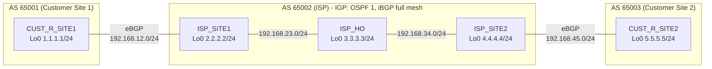

# iBGP and eBGP route distribution lab

A small service-provider style lab that shows how **eBGP** (customer to ISP) and **iBGP** (inside the ISP) work together, with **OSPF** as the ISP's IGP and **next-hop-self** on the edge routers.

**Goal:** the two customer sites can ping each other's Loopback0 interfaces across the ISP.

## Topology



Built in the Sandbox with 5 x Cisco ISR4331 (IOS 15.9). The exported topology is in [`topology.json`](topology.json) and each router's config is in [`configs/`](configs/).

## Addressing

| Router | AS | Loopback0 | Interface | IP address | Connected to |
|---|---|---|---|---|---|
| CUST_R_SITE1 | 65001 | 1.1.1.1/24 | Gi0/0 | 192.168.12.1/24 | ISP_SITE1 Gi0/0 |
| ISP_SITE1 | 65002 | 2.2.2.2/24 | Gi0/0 | 192.168.12.2/24 | CUST_R_SITE1 |
| | | | Gi0/1 | 192.168.23.2/24 | ISP_HO Gi0/0 |
| ISP_HO | 65002 | 3.3.3.3/24 | Gi0/0 | 192.168.23.3/24 | ISP_SITE1 Gi0/1 |
| | | | Gi0/1 | 192.168.34.3/24 | ISP_SITE2 Gi0/0 |
| ISP_SITE2 | 65002 | 4.4.4.4/24 | Gi0/0 | 192.168.34.4/24 | ISP_HO Gi0/1 |
| | | | Gi0/1 | 192.168.45.4/24 | CUST_R_SITE2 Gi0/0 |
| CUST_R_SITE2 | 65003 | 5.5.5.5/24 | Gi0/0 | 192.168.45.5/24 | ISP_SITE2 Gi0/1 |

## Design

| Layer | What it does |
|---|---|
| **OSPF 1 (area 0)** | Runs only inside AS 65002 on ISP_SITE1, ISP_HO and ISP_SITE2. It carries the loopbacks and the internal links so the iBGP peerings (formed between loopbacks) can come up. |
| **iBGP full mesh** | ISP_SITE1, ISP_HO and ISP_SITE2 peer with each other using Loopback0 as `update-source`. iBGP does not re-advertise iBGP-learned routes, so a full mesh is needed. |
| **eBGP** | CUST_R_SITE1 to ISP_SITE1 (AS 65001 to 65002) and ISP_SITE2 to CUST_R_SITE2 (AS 65002 to 65003), over the directly connected links. |
| **next-hop-self** | Set on ISP_SITE1 and ISP_SITE2 toward their iBGP peers (see below). |

## Key configuration

**CUST_R_SITE1 (AS 65001)**
```
router bgp 65001
 network 1.1.1.0 mask 255.255.255.0
 neighbor 192.168.12.2 remote-as 65002
```

**ISP_SITE1 (AS 65002)**
```
router ospf 1
 network 2.2.2.0 0.0.0.255 area 0
 network 192.168.23.0 0.0.0.255 area 0
!
router bgp 65002
 neighbor 3.3.3.3 remote-as 65002
 neighbor 3.3.3.3 update-source Loopback0
 neighbor 3.3.3.3 next-hop-self
 neighbor 4.4.4.4 remote-as 65002
 neighbor 4.4.4.4 update-source Loopback0
 neighbor 4.4.4.4 next-hop-self
 neighbor 192.168.12.1 remote-as 65001
```

**ISP_HO (AS 65002)**
```
router ospf 1
 network 3.3.3.0 0.0.0.255 area 0
 network 192.168.23.0 0.0.0.255 area 0
 network 192.168.34.0 0.0.0.255 area 0
!
router bgp 65002
 network 192.168.23.0
 neighbor 2.2.2.2 remote-as 65002
 neighbor 2.2.2.2 update-source Loopback0
 neighbor 4.4.4.4 remote-as 65002
 neighbor 4.4.4.4 update-source Loopback0
```

**ISP_SITE2 (AS 65002)**
```
router ospf 1
 network 4.4.4.0 0.0.0.255 area 0
 network 192.168.34.0 0.0.0.255 area 0
!
router bgp 65002
 network 192.168.34.0
 neighbor 2.2.2.2 remote-as 65002
 neighbor 2.2.2.2 update-source Loopback0
 neighbor 2.2.2.2 next-hop-self
 neighbor 3.3.3.3 remote-as 65002
 neighbor 3.3.3.3 update-source Loopback0
 neighbor 3.3.3.3 next-hop-self
 neighbor 192.168.45.5 remote-as 65003
```

**CUST_R_SITE2 (AS 65003)**
```
router bgp 65003
 network 192.168.45.0
 network 5.5.5.0 mask 255.255.255.0
 neighbor 192.168.45.4 remote-as 65002
```

Full running configs: [`configs/`](configs/).

## Verification

**1. CUST_R_SITE1 learns the other customer's loopback from the ISP**
```
CUST_R_SITE1#show ip bgp
     Network          Next Hop            Metric LocPrf Weight Path
 *>   1.1.1.0/24       0.0.0.0                  0         32768 i
 *>   5.5.5.0/24       192.168.12.2                           0 65002 65003 i
 *>   192.168.23.0     192.168.12.2                           0 65002 i
 *>   192.168.34.0     192.168.12.2                           0 65002 i
 *>   192.168.45.0     192.168.12.2                           0 65002 65003 i
```

**2. CUST_R_SITE2 learns 1.1.1.0/24 through the ISP**
```
CUST_R_SITE2#show ip bgp
     Network          Next Hop            Metric LocPrf Weight Path
 *>   1.1.1.0/24       192.168.45.4                           0 65002 65001 i
 *>   5.5.5.0/24       0.0.0.0                  0         32768 i
 *>   192.168.23.0     192.168.45.4                           0 65002 i
 *>   192.168.34.0     192.168.45.4             0             0 65002 i
 *>   192.168.45.0     0.0.0.0                  0         32768 i
```

**3. Loopback to loopback ping works in both directions**
```
CUST_R_SITE1#ping 5.5.5.5 source lo0
Packet sent with a source address of 1.1.1.1
!!!!!
Success rate is 100 percent (5/5), round-trip min/avg/max = 35/45/56 ms

CUST_R_SITE2#ping 1.1.1.1 source lo0
Packet sent with a source address of 5.5.5.5
!!!!!
Success rate is 100 percent (5/5), round-trip min/avg/max = 35/43/59 ms
```

## Things this lab shows

- **Why next-hop-self is needed.** When ISP_SITE1 learns `1.1.1.0/24` from the customer, the next hop is `192.168.12.1`. iBGP does not change the next hop, so ISP_HO and ISP_SITE2 would receive a next hop they cannot reach: the customer link is not in OSPF. With `next-hop-self`, the route is advertised with next hop `2.2.2.2`, which every ISP router reaches through OSPF. The same applies in the other direction on ISP_SITE2. ISP_HO has no eBGP peer, so it does not need it.
- **Why a plain `ping 5.5.5.5` fails.** Without `source lo0`, CUST_R_SITE1 uses `192.168.12.1` as the source, and `192.168.12.0/24` is not advertised into BGP, so the reply has no route back (0/5 success). Sourcing from Loopback0 uses `1.1.1.1`, which is advertised, so the ping succeeds.
- **Full mesh requirement.** A router does not pass iBGP-learned routes to another iBGP peer, so all three ISP routers peer with each other. Route reflectors would be the alternative at scale.
- **Loopback masks.** The loopbacks use /24 masks, so the `network` statements in BGP use `/24` to match the connected route exactly. OSPF still advertises them as /32 host routes.

## Try it yourself

1. Import `topology.json` into the Sandbox (or build the topology above).
2. Apply the configs from `configs/`.
3. Check `show ip ospf neighbor` and `show ip bgp summary` on the ISP routers.
4. Run the two ping tests above.
5. Experiment: remove `next-hop-self` on ISP_SITE1 and watch the ping fail, then check `show ip bgp` on ISP_SITE2 to see the unreachable next hop.
